  

  
  
  

### Hi, I'm Gevorg 👋

**AI engineer in Yerevan, Armenia (GMT+4).** I design and ship LLM systems that are grounded, measured and tested: retrieval-augmented assistants that cite their sources, evidence-tracing NLP pipelines, ML models with honest evaluation, and Telegram bots and automations that run 24/7.

I treat an AI feature like any other production system. It needs an evaluation set, a CI pipeline, failure modes that are written down, and a clear "I don't know" when the data doesn't support an answer.

## How I build AI systems

| Principle | Where you can see it |
|---|---|
| **Grounded answers, never invented ones.** Every answer carries the source chunks and scores it came from. | [doc-rag-api](https://github.com/GEV44/doc-rag-api) |
| **Evaluation in CI, not vibes.** Retrieval quality is measured on a fixed eval set on every push. | [doc-rag-api](https://github.com/GEV44/doc-rag-api) |
| **Traceability and documentation.** Each finding links back to a verified quote. The repo ships a model card, data card, evaluation protocol and threat model. | [silent-stakeholder](https://github.com/GEV44/silent-stakeholder) |
| **LLMs that improve wording but never add facts.** The rewrite step is constrained to keep every employer, date and number from the source. | [resume-constructor](https://github.com/GEV44/resume-constructor) |
| **Local-first and vendor-neutral.** Ollama, llama.cpp or any OpenAI-compatible endpoint, with no paid API required. | [doc-rag-api](https://github.com/GEV44/doc-rag-api) · [wardrobe-intelligence-lab](https://github.com/GEV44/wardrobe-intelligence-lab) |
| **Math from first principles when it matters.** Hand-derived gradients and geometry in pure NumPy. | [stereo-distance-calculator](https://github.com/GEV44/stereo-distance-calculator) |

## Featured work

| Project | What it does | Stack |
|---|---|---|
| [**stereo-distance-calculator**](https://github.com/GEV44/stereo-distance-calculator) | Metric distance from two cameras with no deep learning. A learnable 5×5 lens grid per camera, hand-derived gradients checked against finite differences, ZNCC epipolar matching and least-squares triangulation, all in pure NumPy. About 0.1 m mean error on 27 real measurements. | NumPy · computer vision · optimisation |
| [**silent-stakeholder**](https://github.com/GEV44/silent-stakeholder) · [demo ↗](https://gev44.github.io/silent-stakeholder-demo/) | Evidence-grounded LLM pipeline. It joins 3,200 app reviews with 774 public roadmap records and ranks the needs the roadmap misses. All 843 cited quotes are re-matched to source text, and 252 tests plus mypy run in CI. | Python · NLP · Streamlit · pytest · mypy |
| [**resume-constructor**](https://github.com/GEV44/resume-constructor) · [live ↗](https://resume-constructor-gev44.vercel.app) | Full-stack AI resume builder. It scores a resume against a job, rewrites it without inventing facts, and exports ATS-readable PDF and Word. Auth, Postgres with row-level security, Edge Functions, unit and end-to-end tests. | React · TypeScript · Supabase · Vercel |
| [**wardrobe-intelligence-lab**](https://github.com/GEV44/wardrobe-intelligence-lab) · [live ↗](https://wardrobe-intelligence-lab.streamlit.app) | Explainable AI stylist. A transparent scoring engine picks weather- and occasion-aware outfits and learns from feedback, with a local LLM chat (Qwen3 via llama.cpp) in English, Russian and Armenian. 93 tests. | Python · Streamlit · llama.cpp · recommender |
| [**batchcor-rna-embeds**](https://github.com/GEV44/batchcor-rna-embeds) | BostonGene program group project. scGPT embeddings, conditional-autoencoder batch correction and survival prediction on single-cell data. | PyTorch · LightGBM · single-cell |
| [**doc-rag-api**](https://github.com/GEV44/doc-rag-api) | Document Q&A service. Upload PDF, TXT or MD, ask questions, and get answers with cited source chunks. BM25 retrieval works offline. Embeddings and an LLM answer step are optional through any OpenAI-compatible endpoint. Test suite plus a retrieval eval in CI. | Python · FastAPI · BM25 · RAG |

### Private systems (code not public)

| System | What it does | Engineering behind it |
|---|---|---|
| **Sentinel** | 24/7 crypto research and paper-trading engine across Solana, Base and BSC | ~460 tests (risk-property, chaos, API-fuzz, Playwright UI) · independent risk engine with hard limits · 10 pre-registered hypotheses judged on forward data · 30-day tracking of every token |
| **EdgeFinder** | Telegram FX-signal bot: 11 currency pairs × 4 expiries, LightGBM + multi-timeframe features | 2 years of market data · 18-month walk-forward · sealed 3-month test · says **NO TRADE** when no edge is statistically proven |

Write-ups on the [portfolio](https://gev44.github.io).

## Tech stack

**AI / ML:** RAG, embeddings, BM25 and hybrid retrieval, LLM APIs (OpenAI-compatible, Ollama, llama.cpp), evaluation sets, PyTorch, scikit-learn, LightGBM 
**Backend & infra:** Python, FastAPI, PostgreSQL, Supabase, SQLite, Docker, GitHub Actions 
**Bots & automation:** Telegram bots, n8n, Make, scrapers, scheduled jobs, Google Sheets and CRM integrations 
**Frontend:** React, TypeScript, Tailwind

  
  
  
  
  
  
  
  
  
  
  
  
  
  
  
  

## Background

- 🧠 **ML Engineer intern** at Mathrix AI (2026)
- 🧬 **BostonGene program** in bioinformatics and data science in oncology (2025–26)
- 🎓 **B.Sc. Informatics & Applied Mathematics**, Yerevan State University (2023–2027)
- 🗣️ English · Russian · Armenian

**Open to AI engineering roles and freelance projects**, remote or in Yerevan. The fastest way to reach me is [Telegram](https://t.me/hovhannisyan77).

---

<picture>
  <source media="(prefers-color-scheme: dark)" srcset="https://raw.githubusercontent.com/GEV44/GEV44/output/snake-dark.svg">
  
</picture>
